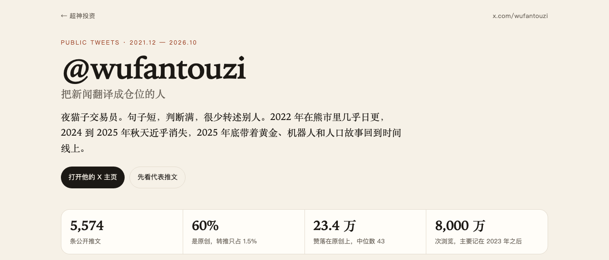
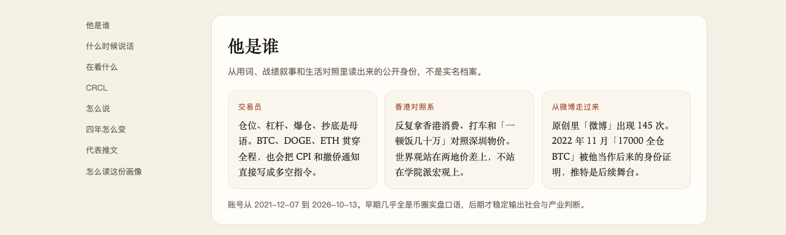
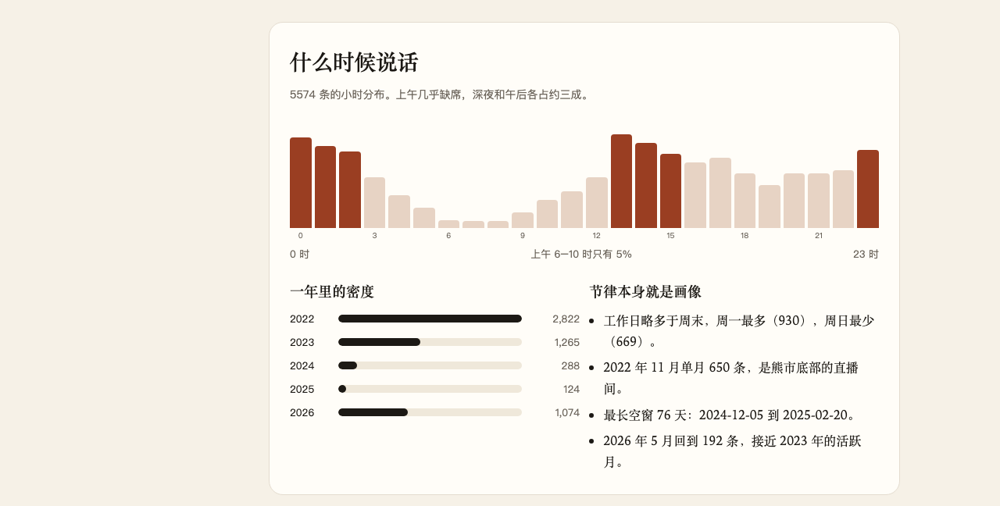
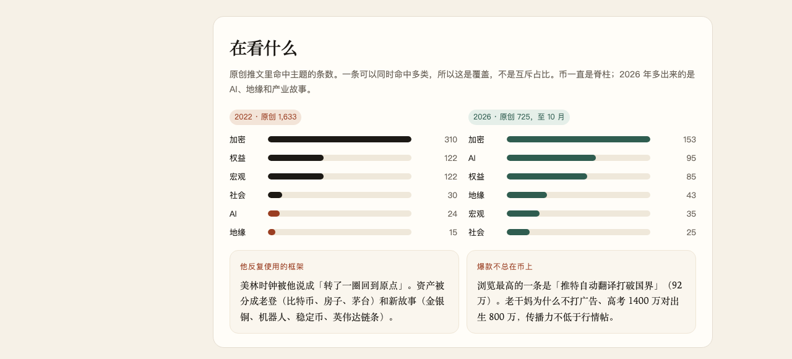
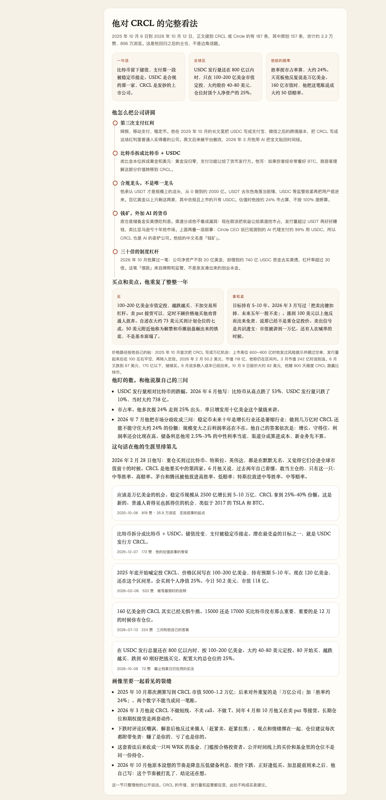
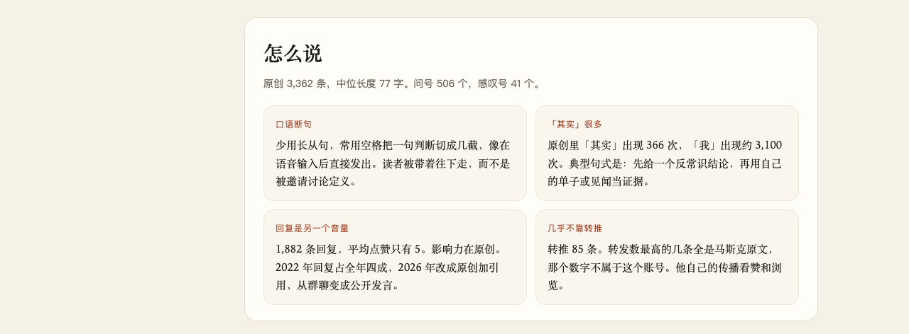
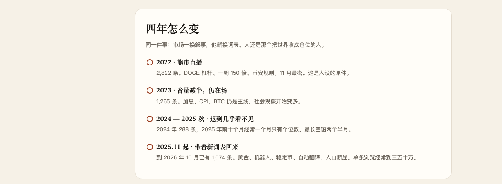
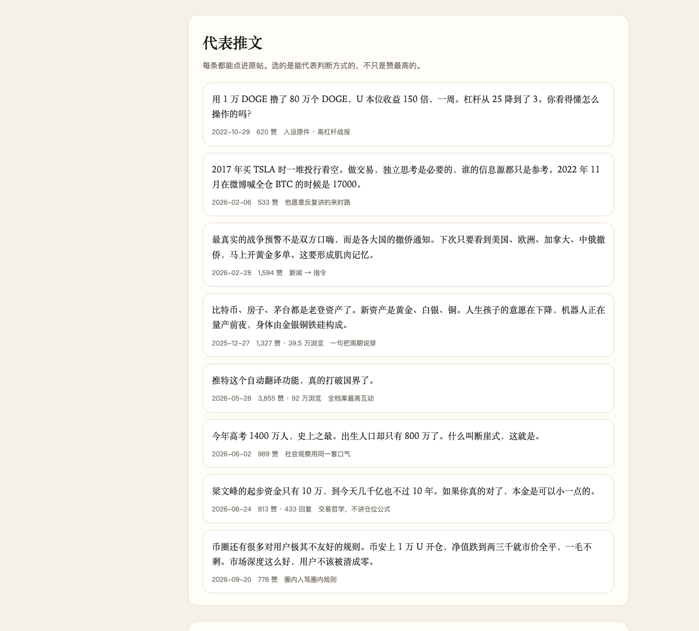

发帖说明（发出去之前删掉这一段）：下面 8 张图在同目录的 `shots/` 里，按出现顺序上传到 X。正文从标题开始复制。完整页面：https://yanleijava.github.io/wufan/

# @wufantouzi：把新闻翻译成仓位的人

夜猫子交易员。句子短，判断满，很少转述别人。2022 年在熊市里几乎日更，2024 到 2025 年秋天近乎消失，2025 年底带着黄金、机器人和人口故事回到时间线上。2025 年 10 月起，CRCL 成了他的主仓。

依据是 2021-12-07 到 2026-10-13 的 5,574 条公开推文。账号在这里：https://x.com/wufantouzi  
画像长页在这里：https://yanleijava.github.io/wufan/

## 他是谁

公开身份从用词里读出来，不是实名档案。仓位、杠杆、爆仓、抄底是母语，BTC、DOGE、ETH 贯穿全程。他反复拿香港消费对照深圳物价。原创里「微博」出现 145 次，2022 年 11 月「17000 全仓 BTC」被他当成后来的身份证明，推特是后一个舞台。

## 什么时候说话

5,574 条里，上午 6–10 点只占 5%。深夜和午后各约三成。工作日略多于周末。

2022 年 2,822 条，11 月单月 650 条，是熊市底部的直播间。最长空窗 76 天，从 2024-12-05 到 2025-02-20。2026 年 5 月回到 192 条。

## 在看什么

币一直是脊柱。2026 年多出来的是 AI、地缘和产业故事。他爱用的框架是美林时钟，以及一套自己的分法：比特币、房子、茅台是老登资产，金银铜、机器人、稳定币是新故事。

浏览最高的一条不是行情帖，是「推特自动翻译打破国界」，大约 92 万浏览、3,855 赞。原创占 60%，转推只占 1.5%。原创中位 77 字，问号 506 个，感叹号 41 个。回复有 1,882 条，平均点赞只有 5，传播力在原创上。

## 他对 CRCL 的完整看法

2025-10-06 到 2026-10-12，正文提到 CRCL 或 Circle 的有 187 条，原创 157 条，大约 2.3 万赞、856 万浏览。

一句话：比特币留下储值，支付那一段被稳定币接走。USDC 是合规的那一家，CRCL 是发钞的上市公司。

他把它讲成五层：

1. 第三次支付红利。网银、移动支付、稳定币。2025 年 10 月的长文后来被删改，2026 年 3 月他用 AI 把全文贴回时间线。
2. 比特币拆成比特币 + USDC。类比黄金拆成黄金和美元：储值还在，支付让给了货币发行方。
3. 合规龙头，不是规模龙头。他承认 USDT 从 0 做到约 2000 亿。USDT 去灰色角落当前锋，USDC 等监管收紧再把用户揽进来。百亿美金以上只剩这两家，合规且上市的只有 USDC。估值按大约 24% 的市占算，不按垄断算。
4. 钱矿，再加一层 AI 货币。底仓是储备金买美债。渠道分成他看成抢市占的成本，发行量超过 USDT 再赚钱。Circle CEO 说已观测到的 AI 代理支付约 99% 用 USDC，所以他管 CRCL 也叫 AI 的卖铲公司。
5. 制度杠杆。2026 年 10 月他算过：净资产不到 20 亿美金，对应大约 740 亿 USDC 资金去买美债，杠杆率超过 30 倍。这笔资金来自牌照，不是亲友凑的本金。

买法他重复了一年。USDC 发行量还在 800 亿以内时，只在 100–200 亿美金市值定投，大约股价 40–80 美元，越跌越买，仓位封顶个人净资产的 25%，不加交易所杠杆。自述在大约 73 美元买到计划仓位的七成。50 美元附近他称为解禁和币圈崩盘砸出来的位置。卖出信号是共识透支：市值被讲到一万亿、还有人在喊单的时候。2026 年 3 月他写过，把卖出键扣掉，未来五年一股不卖。

价格按他自己的帖走：上市高位 600–800 亿时发过风险提示并晒过空单，发行量起来后在 100 左右平空，再转入定投。2026 年 2 月 6 日，50.2 美元、市值 118 亿，他说仍在区间里。3 月市值 242 亿时说别追。6 月又跌到 67 美元、170 亿以下，继续买。9 月说多数人的成本已经回来。10 月 9 日股价大约 82 美元，他赌 900 天维度 CRCL 跑赢比特币。

他盯两个数。一个是发行量相对比特币的跌幅：2026 年 6 月，比特币从高点跌了 53%，USDC 发行量只跌了 10%，当时大约 738 亿。另一个是市占率，他多次报从 24% 走到 25% 出头。

2026 年 7 月他把分歧收成三问，并给了自己的答案：稳定币未来十年是增长行业；做到几万亿时市占还能守住大约 24%；规模变大之后利润率还会比现在高。储备利息他用 2.5%–3% 的中性利率当底，渠道分成算进成本。160 亿美金时，他把对标万亿的赔率说成大约 50 倍，胜率仍按市占率大约 24% 算。

在他自己的排序里，这是第四家。前三家是比特币、特斯拉、英伟达，都是默默无名、又觉得会进全球市值前十的时候买的。2026 年 6 月他又说，过去两年看懂、敢当主仓的，只有 CRCL 这一只。

读的时候要带着这几道裂缝：

- 2025 年 10 月那次测算写到 CRCL 市值 5,000–1.2 万亿；后来反复说的是「万亿公司」加「胜率约 24%」。两笔账不是同一笔。
- 2026 年 3 月他说不做短线、不卖 call、不做 T。同年 4 月和 10 月他又在卖 put 等接货。
- 下跌时评论区嘲讽，解套后他催人赶紧卖、赶紧拉黑。每次仓位建议都附带同一句免责：赚了是你的，亏了也是你的。
- 这套看法后来收成一只叫 WRK 的基金。公开时间线上的买价，和基金里的仓位，不是同一份持仓。
- 他原先等的是降息压低储备利息、股价下跌、正好逢低买。2026 年 10 月加息提前到来，他自己写：节奏被打乱了，结论还在想。

几条原帖，按时间：

- 2025-10-06，定投叙事的起点：https://x.com/wufantouzi/status/1975171860573655100
- 2025-12-07，比特币拆成比特币 + USDC：https://x.com/wufantouzi/status/1997383065367376075
- 2026-02-06，50.2 美元时的自辩：https://x.com/wufantouzi/status/2019751908311797993
- 2026-07-13，三问和「无惧牛熊」：https://x.com/wufantouzi/status/2076590609507234224
- 2026-10-09，截止档案日仍在用的买法：https://x.com/wufantouzi/status/2108566423056400419

## 怎么说，以及四年怎么变

口语断句，像语音输入后直接发出。「其实」在原创里出现 366 次。2022 年回复占全年四成，2026 年改成原创加引用，从群聊变成公开发言。转推 85 条，转发数最高的几条是马斯克原文，那个数字不属于这个账号。

四年是同一件事：市场一换叙事，他就换词表。2022 是熊市直播，2023 音量减半仍在场，2024 到 2025 年秋退到几乎看不见，2025 年 11 月起带着新词表回来。

## 代表推文

选的是能代表判断方式的，不只是赞最高的。每条都能点进原帖，链接在画像页里。

---

这是公开文本的阅读画像，不是心理测验，也不是投资建议。高杠杆战绩是他自己亮出来的样本。浏览量从 2023 年起才普遍有记录，2022 年的影响力会被这组数字低估。CRCL 的市值、发行量和监管都在变。

整理自 5,574 条公开推文，挂在超神投资：https://yanleijava.github.io/wufan/
